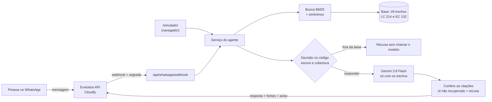

<p></p>

# Inciso — tira-dúvidas da reforma tributária no WhatsApp

Agente de IA que responde, pelo WhatsApp, **dúvidas básicas sobre a reforma tributária brasileira** (EC 132/2023 e LC 214/2025). Toda resposta **cita o artigo de lei** de onde veio, com link para o texto oficial no Planalto; quando a pergunta foge da base, o agente **recusa** em vez de inventar.

Mini-projeto do curso C4 — _Laboratório Introdutório: Construindo um Mini-projeto com IA Generativa_ — da Especialização em Engenharia de Software (UFG/AKCIT).

> **Informativo.** As respostas não substituem a orientação de um contador ou advogado.

## Sumário

- [Como funciona](#como-funciona)
- [Tecnologias](#tecnologias)
- [Instalação e execução local](#instalação-e-execução-local)
- [Uso](#uso)
- [Testes e avaliação](#testes-e-avaliação)
- [Estrutura do projeto](#estrutura-do-projeto)
- [Como a IA foi usada neste projeto](#como-a-ia-foi-usada-neste-projeto)
- [Segurança e privacidade](#segurança-e-privacidade)
- [Limitações e próximos passos](#limitações-e-próximos-passos)
- [Documentação](#documentação)
- [Licença e créditos](#licença-e-créditos)

## Como funciona



1. **Base de conhecimento** ([`knowledge/base.json`](knowledge/base.json)): 29 trechos copiados literalmente do Planalto, um por dispositivo legal, **conferidos por pessoa** no texto oficial ([conferência](docs/conferencia-base.md)).
2. **Busca** lexical (BM25) com redução de plural e sinônimos que ligam o nome do tributo ao jeito como a lei o cita ("IBS" → "art. 156-A").
3. **Decisão no código**, antes de qualquer IA: saudação vira boas-vindas; pergunta sem trecho suficiente (escore e cobertura mínimos) vira **recusa, sem custo de modelo**.
4. **Geração**: o Gemini recebe só os trechos aprovados e cita cada um pelo id (`[lc214-art31]`). O código confere: id que não estava entre os recuperados, ou resposta sem citação, vira recusa. Depois troca o id pela citação legível e acrescenta as fontes com link e o aviso.
5. **Canal**: o mesmo serviço atende o WhatsApp (webhook da Evolution API) e o **simulador web**, que permite avaliar o agente sem WhatsApp.

## Tecnologias

| Camada                           | Tecnologia                                                                                                                             |
| -------------------------------- | -------------------------------------------------------------------------------------------------------------------------------------- |
| Aplicação                        | TanStack Start (React 19, TypeScript estrito), gerada e sincronizada com o [Lovable](https://lovable.dev)                              |
| Validação de entradas            | zod                                                                                                                                    |
| Modelo de linguagem (no produto) | **Gemini 3.8 Flash**, pelo SDK oficial `@google/genai` ([ADR-003](docs/decisoes.md))                                                   |
| WhatsApp                         | **Evolution API v2**, hospedada na Cloudfy                                                                                             |
| Interface                        | Tailwind CSS 4 e componentes Radix; fontes Schibsted Grotesk, Source Serif 4 e IBM Plex Mono servidas pelo próprio app (`@fontsource`) |
| Testes                           | Vitest e Testing Library                                                                                                               |
| IA no desenvolvimento            | **Claude Code (Claude Opus 5.5)** — planejamento, testes, código, revisão e documentação; **Lovable** — template e sincronização       |

Versões travadas em [`bun.lock`](bun.lock).

## Instalação e execução local

**Pré-requisitos:** [Bun](https://bun.sh) 1.3 ou mais recente (o lockfile do projeto é do Bun) e Node.js 22.12 ou mais recente (exigência do TanStack Start).

```bash
git clone https://github.com/assessoriaautomatizaai-blip/post-grad-foundations.git
cd post-grad-foundations
bun install --frozen-lockfile
cp .env.example .env
npm run dev
```

Abra `http://localhost:8080/simulador` (o terminal mostra a porta). Sem chaves no `.env`, o simulador já responde saudações e **recusa** perguntas fora da base; para respostas com o Gemini, preencha `GEMINI_API_KEY` e `GEMINI_MODEL`.

| Variável                                                       | Para quê                                                         |
| -------------------------------------------------------------- | ---------------------------------------------------------------- |
| `GEMINI_API_KEY`, `GEMINI_MODEL`                               | Geração das respostas (plano pago; `gemini-3.8-flash`)           |
| `WEBHOOK_SECRET`                                               | Segredo que a Evolution envia no cabeçalho `x-webhook-secret`    |
| `EVOLUTION_API_URL`, `EVOLUTION_API_KEY`, `EVOLUTION_INSTANCE` | Envio das respostas pelo WhatsApp (URL obrigatoriamente `https`) |

O `.env` é ignorado pelo Git. Em produção, os valores ficam nos segredos do Lovable. Passo a passo da implantação com WhatsApp: [docs/implantacao.md](docs/implantacao.md).

## Uso

**Simulador** — `/simulador`: digite a pergunta; a resposta mostra as fontes como links para o Planalto.

**WhatsApp** — mande a pergunta para o número do agente. Exemplos:

| Pergunta                             | Comportamento                                                        |
| ------------------------------------ | -------------------------------------------------------------------- |
| `oi`                                 | Boas-vindas com perguntas de exemplo                                 |
| `O que é o split payment?`           | Resposta citando "(LC 214/2025, art. 31, caput)", com fontes e aviso |
| `Qual o valor do IPVA do meu carro?` | Recusa: não está na base                                             |

**Webhook** — `POST /api/whatsapp/webhook`, chamado pela Evolution API. Com `WEBHOOK_SECRET` vazio (como no `.env.example`), recusa tudo com **503**; com o segredo configurado, chamada sem o cabeçalho `x-webhook-secret` correto recebe **401**:

```bash
curl -i -X POST http://localhost:8080/api/whatsapp/webhook -H "content-type: application/json" --data '{}'
```

## Testes e avaliação

```bash
npm test        # 223 testes, sem rede e sem chaves
npm run eval    # conjunto-ouro: grava eval/relatorio.md
npm run build   # build de produção
```

**Testes.** Escritos **antes** do código e aprovados pelo autor antes de cada implementação (TDD). Nenhum teste chama o Gemini, a Evolution ou a internet: modelo, cliente HTTP e WhatsApp são falsos nos testes.

**Teste de mutação manual.** Depois de cada etapa, defeitos foram inseridos de propósito no código para confirmar que os testes os pegam: **48 defeitos, 46 detectados de primeira**; 1 era equivalente (não mudava o comportamento) e 1 revelou uma lacuna real, fechada com um teste novo.

**Conjunto-ouro** ([`eval/perguntas.json`](eval/perguntas.json)): 32 perguntas escritas como um leigo perguntaria, com gabarito conferido pelo autor, separadas em calibração (21) e teste (11, nunca usado para ajustar). Resultado de 15/10/2026 ([relatório](eval/relatorio.md)):

|                                                | Calibração     | Teste          |
| ---------------------------------------------- | -------------- | -------------- |
| Perguntas fora do escopo recusadas             | **100%** (6/6) | **100%** (4/4) |
| Trecho certo entre os 3 recuperados (recall@3) | 73%            | 86%            |
| Respondidas usando o trecho certo              | 60%            | 57%            |

O agente erra **do lado seguro**: nenhuma pergunta fora do escopo foi respondida, nem as armadilhas que usam palavras da base ("Quanto custa abrir um MEI?"). Em troca, recusa perguntas que poderia responder — ver [limitações](#limitações-e-próximos-passos).

## Estrutura do projeto

```
knowledge/base.json        base de conhecimento (29 trechos conferidos)
src/core/                  regra de negócio pura e testável: busca, decisão, geração, divisão de mensagens
src/core/prompts/          prompt de sistema do agente (versionado)
src/adapters/              Gemini e Evolution API, atrás de interfaces
src/server/                serviço do agente e webhook (só no servidor)
src/routes/                páginas (/simulador) e rota do webhook
src/eval/  eval/           avaliação pelo conjunto-ouro
scripts/planalto/          extração dos trechos do texto oficial
docs/                      escopo, backlog, decisões, estimativa, registro do uso de IA
```

## Como a IA foi usada neste projeto

O projeto usou IA em dois papéis, com controles diferentes (registro completo em [docs/HISTORY-IA.md](docs/HISTORY-IA.md)):

- **No desenvolvimento** — Claude Code leu o material do curso, propôs escopo, backlog e decisões, escreveu testes e código e conferiu fatos voláteis na fonte. Em cada etapa: a IA propõe os testes, **o autor aprova**, a IA implementa, roda testes, tipos, lint, build e mutações, e o autor aprova antes de cada envio ao GitHub. O contrato desse trabalho está em [CLAUDE.md](CLAUDE.md).
- **No produto** — o Gemini só redige a resposta a partir de trechos já escolhidos pelo código; quem decide responder ou recusar é o código, e as citações do modelo são conferidas.

**Fatos voláteis vieram da fonte, não da memória do modelo:** preços do Gemini (página oficial), forma de chamada do SDK (documentação e tipos instalados), formato do webhook e do envio da Evolution (código-fonte da Evolution, porque a página de documentação estava fora do ar) e o texto da lei (Planalto).

**O que a revisão pegou** — exemplos reais, todos registrados no histórico:

- O `.gitignore` do template **não ignorava `.env`**.
- O Planalto marca a redação revogada com estilo CSS, não só com `<strike>`: a primeira extração **misturava texto revogado** ao vigente.
- Um teste aprovado era fraco: `toThrow("id")` passava porque "inválida" contém "id".
- Medir antes de testar mostrou que **o escore da busca não separava** perguntas dentro e fora do escopo; a decisão foi redesenhada com cobertura.
- A primeira versão engolia o erro do modelo num `catch` vazio — o defeito que o material do curso critica.
- A issue #1340 da Evolution mostrou que as mensagens **enviadas** pelo agente voltam pelo webhook: sem filtro, ele responderia a si mesmo em loop.
- Um teste da rota foi descartado ao se descobrir que o servidor tinha subido **da pasta antiga**; refeito na pasta certa.

**Tempo real investido:** [A PREENCHER pelo autor] (estimativa inicial: 22,5 h — [docs/estimativa.md](docs/estimativa.md)). Ganhos de produtividade não foram medidos e por isso não são afirmados aqui.

## Segurança e privacidade

- Chaves só no `.env` (ignorado) e nos segredos do Lovable; o código do navegador não contém a base, o prompt nem nomes de chaves (conferido no build).
- Webhook com segredo comparado em tempo constante; sem segredo configurado, recusa tudo.
- Logs registram só a causa do erro — **nunca número de telefone nem texto da mensagem** (LGPD).
- Gemini no **plano pago**: no gratuito, o conteúdo enviado pode ser usado pelo Google para melhorar seus produtos.
- A pergunta do usuário vai ao modelo isolada entre delimitadores neutralizados, como dado, não como instrução.

## Limitações e próximos passos

**Limitações conhecidas (medidas, não estimadas):**

- **Recusa demais.** Só 57% a 60% das perguntas dentro do escopo são respondidas; o critério de recall@3 ≥ 80% do escopo **não foi atingido** na calibração (73%). A causa é vocabulário: palavras do dia a dia ausentes da lei, flexão verbal ("compensar" × "compensado") e termos onipresentes ("IBS" aparece em 19 dos 29 trechos).
- **Uma pergunta passa com trecho errado** no conjunto-ouro ("Serviços de saúde vão pagar menos imposto?" recupera o Imposto Seletivo, que fala em "prejudiciais à saúde").
- **Base pequena e manual**: 29 trechos; sem o Anexo I (lista da cesta básica), sem regulamentos, legislação estadual ou municipal. Atualização manual.
- Só mensagens de texto; sem memória entre mensagens; sem limitação de taxa por remetente.
- Deduplicação de mensagens em memória: com várias instâncias do servidor, uma duplicata rara pode passar.
- [A CONFERIR na H12] Comportamento real do Gemini e da Evolution em produção.

**Próximos passos:** busca híbrida (BM25 + embeddings) e tratamento de flexão verbal, medidos contra o mesmo conjunto-ouro; ampliar a base com regulamentações; limitação de taxa; mensagens de voz.

## Documentação

| Documento                                            | Conteúdo                                                 |
| ---------------------------------------------------- | -------------------------------------------------------- |
| [docs/escopo.md](docs/escopo.md)                     | Problema, recorte, fora de escopo e critérios de sucesso |
| [docs/backlog.md](docs/backlog.md)                   | Histórias com critérios de aceite e releases             |
| [docs/decisoes.md](docs/decisoes.md)                 | Decisões técnicas (ADRs)                                 |
| [docs/estimativa.md](docs/estimativa.md)             | Esforço e custo                                          |
| [docs/HISTORY-IA.md](docs/HISTORY-IA.md)             | Registro do uso de IA, etapa por etapa                   |
| [docs/conferencia-base.md](docs/conferencia-base.md) | Conferência humana dos trechos e sinônimos               |
| [docs/implantacao.md](docs/implantacao.md)           | Implantação com Lovable, Gemini e Evolution              |
| [docs/marca/](docs/marca/cores-e-fontes.md)          | Marca Inciso: logotipo, ícones, cores e fontes           |

## Marca

O nome **Inciso** vem da subdivisão de artigo de lei — o agente sempre aponta o dispositivo de onde tirou a resposta. O símbolo "I –" é o traço do I seguido do travessão que separa os incisos no texto legal. Arquivos (SVG e PNG, inclusive a foto de perfil do WhatsApp), cores e fontes estão em [docs/marca/](docs/marca/cores-e-fontes.md). A busca de anterioridade no INPI foi preliminar [A CONFERIR].

## Licença e créditos

Código sob a [licença MIT](LICENSE). Os textos legais em `knowledge/` são normas públicas (EC 132/2023 e LC 214/2025), reproduzidas do Planalto.

Autor: assessoriaautomatizaai-blip · Curso C4 da Especialização em Engenharia de Software — UFG/AKCIT. Desenvolvido com apoio de Claude Code (Anthropic); aplicação gerada a partir de template do Lovable.
