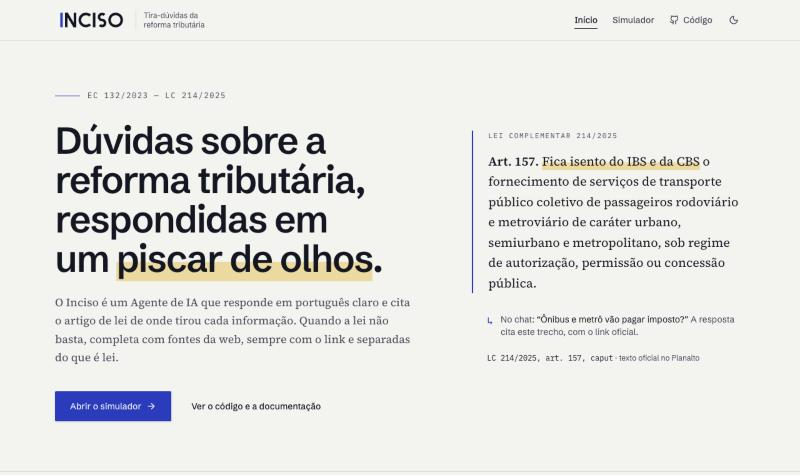
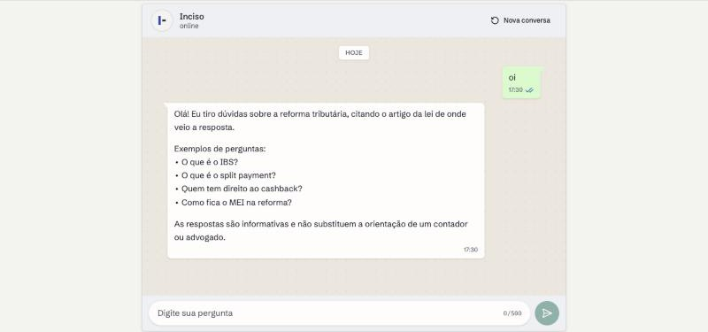
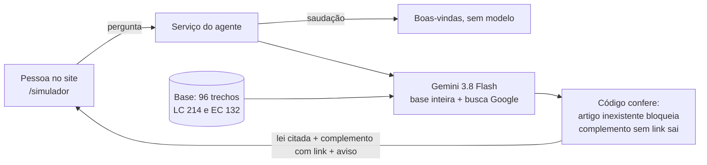

<p></p>

# Inciso — chat com IA que tira dúvidas sobre a reforma tributária

O Inciso é um **chat com inteligência artificial**: a pessoa escreve, no site, uma dúvida sobre a **reforma tributária brasileira** (EC 132/2023 e LC 214/2025) e recebe a resposta em linguagem simples, como numa conversa. Toda resposta **cita o artigo de lei** de onde veio, com link para o texto oficial no Planalto; quando a lei não basta, o agente **completa com busca na web**, sempre com o link e separado do que é lei. Artigo inventado nunca chega ao usuário: o código confere.

**Experimente:** abra **https://inciso.lovable.app/simulador** e pergunte, por exemplo, _"O que é o split payment?"_ ou _"O ISS vai acabar?"_. A página de conversa se chama `/simulador` por razões históricas do projeto; é o chat.

Mini-projeto do curso C4 — _Laboratório Introdutório: Construindo um Mini-projeto com IA Generativa_ — da Especialização em Engenharia de Software (UFG/AKCIT).

> **Informativo.** As respostas não substituem a orientação de um contador ou advogado.

## Sumário

- [Demonstração](#demonstração)
- [Como funciona](#como-funciona)
- [Tecnologias](#tecnologias)
- [Instalação e execução local](#instalação-e-execução-local)
- [Uso](#uso)
- [Testes e avaliação](#testes-e-avaliação)
- [Estrutura do projeto](#estrutura-do-projeto)
- [Como a IA foi usada neste projeto](#como-a-ia-foi-usada-neste-projeto)
- [Segurança e privacidade](#segurança-e-privacidade)
- [Limitações e próximos passos](#limitações-e-próximos-passos)
- [Documentação](#documentação)
- [Licença e créditos](#licença-e-créditos)

## Demonstração

Site publicado: **https://inciso.lovable.app** — página inicial e o **chat** em [`/simulador`](https://inciso.lovable.app/simulador).





Capturas de 16/10/2026, do servidor local. A resposta com o LLM (lei citada e complemento da web com link) foi verificada pelo autor no Lovable em 15/10/2026.

## Como funciona



1. **Base de conhecimento** ([`knowledge/base.json`](knowledge/base.json)): 96 trechos copiados literalmente do Planalto, um por dispositivo legal, todos conferidos automaticamente contra o texto vigente (já com a LC 227/2026). Os 29 originais foram conferidos também por pessoa; os 67 da ampliação de 15/10/2026 aguardam essa conferência ([conferência](docs/conferencia-base.md)).
2. **O Gemini lê a base inteira** em toda pergunta e raciocina sobre ela: entende paráfrase ("deixa de existir" = "ficam extintos") sem lista de sinônimos. Tudo o que vem da base cita o trecho pelo id (`[lc214-art31]`).
3. **Busca no Google** completa o que a lei não cobre (prazos, notas fiscais, comunicados), num parágrafo "_Complemento:_" com os links das páginas, identificados como **não conferidos**.
4. **O código confere antes de enviar** ([ADR-007](docs/decisoes.md)): artigo citado que não existe na base bloqueia a resposta; complemento sem fonte da web é removido; resposta sem fonte nenhuma vira mensagem fixa; assunto fora da reforma vira mensagem que explica o foco do agente. Saudação recebe boas-vindas sem chamar o modelo.
5. **Canal**: o agente é entregue no **site** (página inicial e simulador). O repositório ainda contém um adaptador para WhatsApp (webhook da Evolution API), implementado e testado com dados simulados, mas **fora do escopo desta entrega e não ativado** (ver Limitações).

## Tecnologias

| Camada                           | Tecnologia                                                                                                                             |
| -------------------------------- | -------------------------------------------------------------------------------------------------------------------------------------- |
| Aplicação                        | TanStack Start (React 19, TypeScript estrito), gerada e sincronizada com o [Lovable](https://lovable.dev)                              |
| Validação de entradas            | zod                                                                                                                                    |
| Modelo de linguagem (no produto) | **Gemini 3.8 Flash** com busca no Google, pelo SDK oficial `@google/genai` ([ADR-003 e ADR-007](docs/decisoes.md))                     |
| Canal WhatsApp (não ativado)     | Adaptador para a Evolution API v2 no código, fora do escopo desta entrega                                                              |
| Interface                        | Tailwind CSS 4 e componentes Radix; fontes Schibsted Grotesk, Source Serif 4 e IBM Plex Mono servidas pelo próprio app (`@fontsource`) |
| Testes                           | Vitest e Testing Library                                                                                                               |
| IA no desenvolvimento            | **Claude Code (Claude Opus 5.5)** — planejamento, testes, código, revisão e documentação; **Lovable** — template e sincronização       |

Versões travadas em [`bun.lock`](bun.lock).

## Instalação e execução local

**Pré-requisitos:** [Bun](https://bun.sh) 1.3 ou mais recente (o lockfile do projeto é do Bun) e Node.js 22.12 ou mais recente (exigência do TanStack Start).

```bash
git clone https://github.com/assessoriaautomatizaai-blip/post-grad-foundations.git
cd post-grad-foundations
bun install --frozen-lockfile
cp .env.example .env
npm run dev
```

Abra `http://localhost:8080/simulador` (o terminal mostra a porta). Sem chaves no `.env`, o simulador já responde saudações; as demais perguntas mostram a mensagem de falha técnica até você preencher `GEMINI_API_KEY` e `GEMINI_MODEL` (a busca no Google exige o plano pago).

| Variável                                                                         | Para quê                                                                       |
| -------------------------------------------------------------------------------- | ------------------------------------------------------------------------------ |
| `GEMINI_API_KEY`, `GEMINI_MODEL`                                                 | Geração das respostas (plano pago; `gemini-3.8-flash`)                         |
| `WEBHOOK_SECRET`, `EVOLUTION_API_URL`, `EVOLUTION_API_KEY`, `EVOLUTION_INSTANCE` | Só para o adaptador de WhatsApp, não ativado nesta entrega; podem ficar vazias |

O `.env` é ignorado pelo Git. Em produção, os valores ficam nos segredos do Lovable.

## Uso

**Simulador** — `/simulador`: digite a pergunta; a resposta mostra as fontes da lei como links para o Planalto e, quando houver, as fontes da web à parte, como não conferidas.

Exemplos:

| Pergunta                    | Comportamento                                                        |
| --------------------------- | -------------------------------------------------------------------- |
| `oi`                        | Boas-vindas com perguntas de exemplo                                 |
| `O que é o split payment?`  | Resposta citando "(LC 214/2025, art. 31, caput)", com fontes e aviso |
| `O IPVA acaba?`             | Complemento com fonte da web, separado do que é lei                  |
| `Qual a previsão do tempo?` | Mensagem que explica o foco do agente e sugere perguntas             |

**Webhook do adaptador de WhatsApp (não ativado)** — `POST /api/whatsapp/webhook`. Com `WEBHOOK_SECRET` vazio (como no `.env.example`), recusa tudo com **503**; com o segredo configurado, chamada sem o cabeçalho `x-webhook-secret` correto recebe **401**:

```bash
curl -i -X POST http://localhost:8080/api/whatsapp/webhook -H "content-type: application/json" --data '{}'
```

## Testes e avaliação

```bash
npm test        # 259 testes, sem rede e sem chaves
npm run build   # build de produção
```

**Testes.** Escritos **antes** do código e aprovados pelo autor antes de cada implementação (TDD). Nenhum teste chama o Gemini ou a internet: modelo e cliente HTTP são falsos nos testes. As garantias do [ADR-007](docs/decisoes.md) (artigo inventado bloqueia, complemento sem link sai, resposta sem fonte não aparece) são testadas no núcleo.

**Teste de mutação manual.** Depois de cada etapa, defeitos foram inseridos de propósito no código para confirmar que os testes os pegam: **48 defeitos, 46 detectados de primeira**; 1 era equivalente (não mudava o comportamento) e 1 revelou uma lacuna real, fechada com um teste novo.

**Avaliação com o conjunto-ouro** ([`eval/perguntas.json`](eval/perguntas.json)): 34 perguntas escritas como um leigo perguntaria, com gabarito conferido pelo autor. O [relatório de 15/10/2026](eval/relatorio.md) mediu o **método anterior** (busca por palavras, ADR-004): 100% de recusa fora do escopo, mas só 60% a 71% das perguntas válidas respondidas. Com o ADR-007, a avaliação passa a chamar o Gemini de verdade (rede e chave) e está sendo refeita.

## Estrutura do projeto

```
knowledge/base.json        base de conhecimento (96 trechos literais do Planalto)
src/core/                  regra de negócio pura e testável: saudação, prompt, conferência de fontes, divisão de mensagens
src/core/prompts/          prompt de sistema do agente (versionado)
src/adapters/              Gemini (e o adaptador de WhatsApp não ativado), atrás de interfaces
src/server/                serviço do agente e webhook (só no servidor)
src/routes/                páginas (/simulador) e rota do webhook
eval/                      conjunto-ouro e relatório da avaliação anterior
scripts/planalto/          extração dos trechos do texto oficial
docs/                      escopo, backlog, decisões, estimativa, registro do uso de IA
```

## Como a IA foi usada neste projeto

O projeto usou IA em dois papéis, com controles diferentes (registro completo em [docs/HISTORY-IA.md](docs/HISTORY-IA.md)):

- **No desenvolvimento** — Claude Code leu o material do curso, propôs escopo, backlog e decisões, escreveu testes e código e conferiu fatos voláteis na fonte. Em cada etapa: a IA propõe os testes, **o autor aprova**, a IA implementa, roda testes, tipos, lint, build e mutações, e o autor aprova antes de cada envio ao GitHub. O contrato desse trabalho está em [CLAUDE.md](CLAUDE.md).
- **No produto** — o Gemini lê a base inteira de lei e completa com busca no Google; o código confere as citações (artigo inexistente bloqueia a resposta) e exige link em todo complemento da web ([ADR-007](docs/decisoes.md)).

**Fatos voláteis vieram da fonte, não da memória do modelo:** preços do Gemini (página oficial), forma de chamada do SDK (documentação e tipos instalados), formato do webhook e do envio da Evolution (código-fonte da Evolution, porque a página de documentação estava fora do ar) e o texto da lei (Planalto).

**O que a revisão pegou** — exemplos reais, todos registrados no histórico:

- O `.gitignore` do template **não ignorava `.env`**.
- O Planalto marca a redação revogada com estilo CSS, não só com `<strike>`: a primeira extração **misturava texto revogado** ao vigente.
- Um teste aprovado era fraco: `toThrow("id")` passava porque "inválida" contém "id".
- Medir antes de testar mostrou que **o escore da busca não separava** perguntas dentro e fora do escopo; a decisão foi redesenhada com cobertura.
- A primeira versão engolia o erro do modelo num `catch` vazio — o defeito que o material do curso critica.
- A issue #1340 da Evolution mostrou que as mensagens **enviadas** pelo agente voltam pelo webhook: sem filtro, ele responderia a si mesmo em loop.
- Um teste da rota foi descartado ao se descobrir que o servidor tinha subido **da pasta antiga**; refeito na pasta certa.

**Tempo real investido:** [A PREENCHER pelo autor] (estimativa inicial: 22,5 h — [docs/estimativa.md](docs/estimativa.md)). Ganhos de produtividade não foram medidos e por isso não são afirmados aqui.

## Segurança e privacidade

- Chaves só no `.env` (ignorado) e nos segredos do Lovable; o código do navegador não contém a base, o prompt nem nomes de chaves (conferido no build).
- Webhook com segredo comparado em tempo constante; sem segredo configurado, recusa tudo.
- Logs registram só a causa do erro — **nunca número de telefone nem texto da mensagem** (LGPD).
- Gemini no **plano pago**: no gratuito, o conteúdo enviado pode ser usado pelo Google para melhorar seus produtos.
- A pergunta do usuário vai ao modelo isolada entre delimitadores neutralizados, como dado, não como instrução.
- Links da web só aparecem se forem `http` ou `https`; o texto do modelo é mostrado como texto, sem interpretar HTML.

## Limitações e próximos passos

**Limitações conhecidas:**

- **Complemento da web não é conferido por pessoa.** A página pode estar desatualizada ou ser fraca; por isso aparece separada da lei, com link e o rótulo "não conferida". O código não julga a qualidade da página.
- **O código confere a existência da fonte, não a fidelidade do texto.** Ele garante que o artigo citado existe na base e que o complemento tem link, mas não que a frase resume corretamente o trecho. Isso depende do modelo e é o que a avaliação com o Gemini mede.
- **Avaliação do método atual em andamento**: o relatório publicado é do método anterior.
- **Custo e tempo maiores por pergunta**: a base inteira vai em cada chamada (~11 mil tokens de entrada, ≈ US$ 0,011 por resposta) e a busca deixa a resposta mais lenta (tempo limite de 25 s). A busca exige o **plano pago** do Gemini (5.000 buscas grátis por mês).
- **Base manual**: 96 trechos; sem os anexos (listas por código NCM), regulamentos, legislação estadual ou municipal. Os 67 trechos da ampliação aguardam conferência humana.
- **Canal WhatsApp fora desta entrega:** o adaptador da Evolution API está no código e testado com dados simulados, mas não foi ativado nem validado em produção.
- Só perguntas de texto; sem memória entre perguntas; sem limitação de taxa por usuário.
- Deduplicação de mensagens em memória: com várias instâncias do servidor, uma duplicata rara pode passar.
- [A CONFERIR] Os links devolvidos pela busca podem ser endereços de redirecionamento do Google, e não o endereço final da página.

**Próximos passos:** avaliação com o Gemini sobre o conjunto-ouro; camada de orientação oficial (trechos literais da Receita e do CGIBS, conferidos); limitação de taxa; mensagens de voz.

## Documentação

| Documento                                            | Conteúdo                                                 |
| ---------------------------------------------------- | -------------------------------------------------------- |
| [docs/escopo.md](docs/escopo.md)                     | Problema, recorte, fora de escopo e critérios de sucesso |
| [docs/backlog.md](docs/backlog.md)                   | Histórias com critérios de aceite e releases             |
| [docs/decisoes.md](docs/decisoes.md)                 | Decisões técnicas (ADRs)                                 |
| [docs/estimativa.md](docs/estimativa.md)             | Esforço e custo                                          |
| [docs/HISTORY-IA.md](docs/HISTORY-IA.md)             | Registro do uso de IA, etapa por etapa                   |
| [docs/conferencia-base.md](docs/conferencia-base.md) | Conferência humana dos trechos e sinônimos               |
| [docs/implantacao.md](docs/implantacao.md)           | Roteiro do canal WhatsApp (não ativado nesta entrega)    |
| [docs/marca/](docs/marca/cores-e-fontes.md)          | Marca Inciso: logotipo, ícones, cores e fontes           |

## Marca

O nome **Inciso** vem da subdivisão de artigo de lei — o agente sempre aponta o dispositivo de onde tirou a resposta. O símbolo "I –" é o traço do I seguido do travessão que separa os incisos no texto legal. Arquivos (SVG e PNG, inclusive a foto de perfil do WhatsApp), cores e fontes estão em [docs/marca/](docs/marca/cores-e-fontes.md). A busca de anterioridade no INPI foi preliminar [A CONFERIR].

## Licença e créditos

Código sob a [licença MIT](LICENSE). Os textos legais em `knowledge/` são normas públicas (EC 132/2023 e LC 214/2025), reproduzidas do Planalto.

Autor: assessoriaautomatizaai-blip · Curso C4 da Especialização em Engenharia de Software — UFG/AKCIT. Desenvolvido com apoio de Claude Code (Anthropic); aplicação gerada a partir de template do Lovable.
